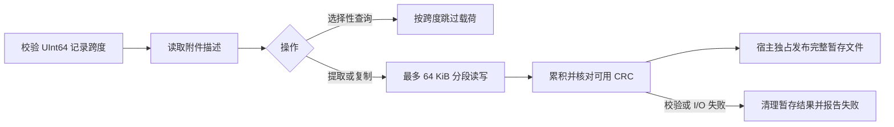

# 大附件的范围读取与流式写入

录制中可以夹带摄像头标定包、诊断快照和其他二进制制品。附件使用 64 位长度。上游无索引查询受默认 64 MiB 整文件回退预算限制，外部合并按普通记录整块读取时受默认 16 MiB 记录预算限制。补丁保留这两项预算，为无索引查询增加按记录跨度跳过附件的入口，为附件载荷提供最多 64 KiB 的传输窗口。

## 入口

```sh
moon build cmd/mcap --target js
node _build/js/debug/build/cmd/mcap/mcap.js scan-query capture.mcap --topic /events --start 20 --end 20
node _build/js/debug/build/cmd/mcap/mcap.js attachment-list capture.mcap
node _build/js/debug/build/cmd/mcap/mcap.js attachment-extract capture.mcap RECORD_OFFSET calibration.bin
node _build/js/debug/build/cmd/mcap/mcap.js validate-range capture.mcap
```

`attachment-list` 返回十进制记录偏移和附件长度，同名附件以偏移区分。参数 `RECORD_OFFSET` 取自列表，输出文件名由调用者指定。提取沿用同目录暂存和独占发布，校验失败时清理暂存结果。已有 `external-merge` 可按原参数直接处理输入中的大附件。

MoonBit 调用方通过 `RangeReader::visit_attachments` 访问物理附件记录，回调返回 `false` 可停止。`AttachmentRef::info` 提供描述，`AttachmentRef::copy_to` 将数据递交给 `WriteSink`，并报告是否核对了可用的附件 CRC。引用在原 `ReadSource` 稳定且可读取时有效。

`StreamWriter::add_attachment_from` 可写入长度已知的字节源。`StreamWriter::copy_attachment` 保留源附件的时间、名称、媒体类型和载荷，写入时重算 CRC、索引和统计。写入中断将进入失败状态。直接持有 sink 的调用方负责清理部分输出。

## 查询和校验

- `query_scan` 按物理记录扫描，跳过顶层附件载荷和不匹配的平铺消息载荷。按原查询契约保留闭区间、等时物理顺序和分页。声明和匹配消息各有字节预算。读取分块时仍遵守原有分块和解压限制。
- `validate-range` 对附件按窗口核对可用 CRC，同时计算数据区 CRC，并使用现有的摘要统计与索引检查。报告中的 `data_crc_verified` 表示文件确有可用且匹配的全段 CRC。
- `scan_source_streaming` 的可选 `attachment_ref` 回调交付描述引用，代替一次性附件回调。该模式继续校验整段数据。既有的 `RecordRead` 与 `RecordAccepted` 事件用 Int32 表示跨度，超过该范围的流式附件使用 `RecordStart` 与后续数据区事件。
- `copy_clip_auxiliary` 继续按名称筛选附件。已选择附件在复制和全量校验时分别读取，额外的读取成本换取现有扫描验证语义。

## 同输入复核

固定基线为 `e99a19f101092c982189d85d9536cf47eb5587c4`。用 Foxglove Python Writer 生成 **67,174,797 字节**的无索引录制，包含 **67,174,400 字节**的附件。上游基线与本补丁保持默认普通记录上限 **16 MiB**。

| 操作 | 上游基线 | 应用补丁后 |
| --- | --- | --- |
| 查询附件之后的单条消息 | 原查询入口达到整文件回退上限 | `scan-query` 发出 15 次范围请求，共 270 字节，准确得到 20 ns 的消息 |
| 外部合并两个录制 | 遇到附件时触发普通记录预算 | 原命令完成，独立 Python 读取器核对三条消息、附件、元数据与新索引 |
| 导出附件 | 公开附件接口接收完整负载 | 分段导出，核对附件 CRC 与 SHA-256 |

范围字节数是 `ReadSource` 的逻辑读取量。宿主的预读和操作系统缓存有各自的实际 I/O。损坏附件 CRC、损坏 DataEnd CRC 和已存在目标文件也在复核脚本中验证。



原 `query` 继续保留其回退行为，新增路径使用 `scan-query`。没有可用附件 CRC 时，提取结果明确报告未校验；SHA-256 由复验脚本独立计算，不是文件宿主发布前的运行时条件。

```sh
git worktree add --detach _interop/baseline e99a19f101092c982189d85d9536cf47eb5587c4
python -m pip install --target _interop_deps mcap==1.6.0 lz4==4.4.5 zstandard==0.25.0
python tools/attachment_stream_workflows.py --baseline _interop/baseline
moon test --target js --deny-warn
moon test --target wasm --deny-warn
```

脚本将同输入对照结果写入 `_interop/attachment-stream-report.json`。文件级复核运行在 Node，Wasm 测试覆盖核心 API 的窗口上限、CRC、顺序及失败状态。

## 索引、异步和恢复

`attachment_catalog` 可以按附件索引定位描述，或在统计不完整时扫描记录。请求 `verify_coverage=true` 时逐一核对真实物理记录边界。选择器支持名称、媒体类型、时间、分页及 UInt64 载荷总预算。`read_range` 用于有界切片，`verify_payload` 则读取整个附件核对可用 CRC。

`start_copy` 创建增量提取会话，`step` 限定每次字节数和窗口数。`checkpoint` 记录源描述和提取进度，恢复前按窗口比对已经写出的前缀。asyncio 包提供同格式检查点和逐段背压。批量导出先检查目标键冲突，再逐文件提交并保存回执。完成日志由存储适配器持久化，重新载入时核对输入身份与已发布输出。

`AttachmentExportJournal` 在附件 CRC 核对后、发布之前持久化待发布记录，发布后再保存完成收据。若进程在两次保存之间退出，恢复需要 `reconcile_pending` 对待发布输出作权威核对。返回 `true` 表示内容与归属均匹配，补记完成；返回 `false` 表示已确认目标不存在，可以重新导出；内容改变或状态不明应抛错。默认拒绝存在待发布记录的恢复。已完成收据仍逐项调用 `verify_output`，旧版无待发布字段的完成边界快照可读取。

存储适配器负责快照的原子持久化、输出所有权和暂存文件清理。Node 的便捷批量命令提供逐文件发布，持久化日志需由应用显式接入；多文件发布没有整体原子性。CRC 缺失时应按未校验处理，恢复核对也不能只比较文件名或长度。

```sh
node _build/js/debug/build/cmd/mcap/mcap.js attachment-catalog capture.mcap
node _build/js/debug/build/cmd/mcap/mcap.js attachment-range capture.mcap RECORD_OFFSET 0 32
node _build/js/debug/build/cmd/mcap/mcap.js attachment-export capture.mcap EXISTING_DIRECTORY
node tools/attachment_wasm.mjs capture.mcap list
node tools/attachment_wasm.mjs capture.mcap extract RECORD_OFFSET new.bin
```

Wasm 文件入口在 Node 中加载真实编译产物，范围读取、输出提交及文件稳定性检查由宿主提供。复核脚本实际提取约 64 MiB 附件，并与参考 SHA-256 比较。支持范围和统计也写入 [本期申报说明](contest-proposal.md)。
